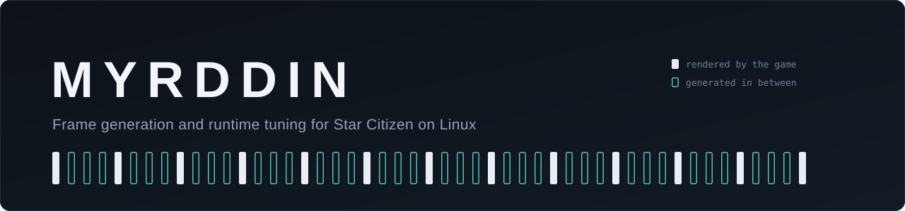

<p align="center">
  
</p>

# Myrddin

Myrddin makes Star Citizen run better on Linux without touching the game. It works in the
layers the game already runs through: a Vulkan layer on the host side of Wine that generates
frames, a launcher that controls it while the game runs, and a patch and tools for the Wine
runner underneath.

> [!WARNING]
> **Experimental and under active development.** Myrddin has been built and tested on exactly
> one machine, listed under [Tested configuration](#tested-configuration). Everything else is
> untested: a game patch, a driver update, another GPU or another desktop can break it.
>
> Star Citizen is protected by Easy Anti-Cheat. Myrddin does not modify the game, its files or
> its memory and sends it no input, but it is not affiliated with or endorsed by Cloud Imperium
> Games and comes with no guarantee of any kind. You use it at your own risk.

## What it does

**Frame generation.** `sc_fg` is a Vulkan layer, loaded the way MangoHud is. It takes the
motion vectors and depth the game hands to DLSS, runs AMD's FSR 3.1 frame interpolation
between each pair of the game's frames, and presents one to three generated frames in between.

- Multipliers ×2, ×3 and ×4, set at launch and changed while the game runs. The multiplier
  follows the game's rate: the fewest generated frames that fill the display.
- The HUD stays sharp. The game draws its HUD into a layer of its own; `sc_fg` captures that
  layer and puts it over every generated frame instead of interpolating it. A picture-based
  detection is the fallback.
- The game's motion vectors are checked against the picture, which cures thin objects that
  flicker because their vectors are wrong.
- Real and generated frames are spaced evenly and limited to the display's refresh rate.
- A performance panel over the picture: the shown rate, the game's own rate, a pacing graph.
- Everything is switched from outside while the game runs, and frame dumps and an event
  record are there for diagnosis.

On the test machine, a heavy hangar scene that the game renders at 24 to 28 frames a second is
shown at 97 to 110 with ×4. Generated frames are interpolated: they add smoothness, not
responsiveness, and each real frame is shown a little later than it would be without them.

**Runner work.** [`wine/`](wine/README.md) holds a Wine patch that implements the CPU-set and
EcoQoS calls Star Citizen makes on Windows, and tools that place and measure the game's threads
from outside. Measured in the game, leaving every thread on every CPU was 4 to 6 % faster, so
the patch is off by default and kept as an option.

**Measurement.** A passive probe layer, comparisons of two settings within one session
(`sc-turbo fg-ab`, `sc-turbo threads-ab`), and a headless test chain that exercises the
frame-generation layer without the game.

## How it works

```
 Star Citizen        Vulkan renderer, DLSS as the upscaler
      │
 Wine (winevulkan)   Windows calls become host Vulkan calls
      │
 sc_fg               · the views handed to DLSS  ->  copies of motion vectors and depth
                     · the game's HUD pass       ->  copies of the HUD layer and the scene under it
                     · at present: FSR 3.1 interpolation on a Vulkan device of its own,
                       HUD put over the result, frames paced into the swapchain
      │
 NVIDIA driver  ->  compositor  ->  display
```

The layer adds copies into images of its own to the game's command stream, asks for more
swapchain images and holds the game's present call to pace frames. It changes none of the
game's data. `sc-turbo` talks to it through control files, never through the game.

## Tested configuration

This is the only configuration Myrddin has run on.

| | |
|---|---|
| Distribution | Fedora Linux 44 (COSMIC) |
| Kernel | 7.2.15-200.fc44.x86_64 |
| Architecture | x86_64 |
| Desktop | COSMIC 1.11.0, Wayland session |
| GPU and driver | NVIDIA GeForce RTX 4070 SUPER, 12 GB; driver 615.78.08 |
| CPU | Intel Core i5-13600K (6 P-cores with SMT, 8 E-cores) |
| Wine runner | `lug-wine-tkg-experimental-wayland-git-11.20-2` (Wine 11.20, Wayland driver) |
| Game | Star Citizen Alpha 4.10.3 (LIVE), Vulkan renderer, DLSS |
| Display | 2560×1440 at 120 Hz |

## Requirements and limitations

- **NVIDIA GPUs only.** Frame generation reads what the game gives to DLSS, through
  NVIDIA-only Vulkan extensions (`VK_NVX_image_view_handle`, `VK_NVX_binary_import`). DLSS
  must be the upscaler selected in the game, which under Wine needs NVAPI (`nvapi64.dll` from
  dxvk-nvapi) and the driver's NGX libraries in the prefix; the LUG Helper can set both up.
  AMD and Intel GPUs are not supported. A fallback without the game's vectors exists
  (`SC_FG_FALLBACK=1`) and has never been tested.
- **One renderer, one kind of runner.** The game's Vulkan renderer under Wine with the Wayland
  driver. X11, Proton and other runners are untested.
- **Tied to the current game build.** Finding the HUD layer and matching frames to their
  inputs rely on how Alpha 4.10 builds a frame. A patch can break either; the layer then falls
  back or has to be switched off (`sc-turbo fg-off`).
- **120 Hz is assumed.** The layer does not read the display's refresh rate: set
  `SC_FG_TARGET` for another one. Other rates and variable refresh are untested.
- **GPU memory.** The layer keeps buffers of its own, and their size has not been reduced yet.
  On the 12 GB test card the game runs close to the limit: switching the upscaler to native
  resolution in a running session exhausted it, turned generation off, and a driver hang
  followed. Leave headroom and do not change the upscaling mode during a session.
- **Known gaps.** Markers pinned to the world and the ship's flight display move at the game's
  frame rate, not the shown one. A first attempt is in the layer, off by default
  (`sc-turbo fg-params markers=1`); the version meant to replace it is being worked out in
  [`proto/hud-motion`](proto/hud-motion). In the pause menu, or while the view stands still,
  the generated rate can drop until the view moves; a fallback for that is in the source and
  not yet validated.
- **Desktop integration is for COSMIC.** Setting up the panel's key and naming the display the
  game should use work there. Elsewhere, bind `sc-turbo fg-panel` to a key by hand.
- **The Wine patch** applies to Wine 11.20 and acts only on hybrid CPUs.
- **No installer, no packages.** x86_64 only.

## Building from source

Fedora package names; other distributions have the same tools under other names.

```sh
sudo dnf install clang gcc cmake ninja-build glslang python3 \
                 vulkan-headers vulkan-loader-devel wayland-devel wayland-protocols-devel

git clone https://github.com/Cadwaladr/Myrddin.git
cd Myrddin
./build.sh            # AMD's library (once), both layers, the test program
./build.sh install    # puts the new layer in place; not while the game runs
```

`build.sh` writes only into `build/`. The Wayland packages are needed for the test program
alone; the tests themselves (`tools/test-chain.sh`, `tools/fg-validate.sh`) run in a headless
Weston and need `weston`, `python3-numpy` and `python3-pillow`. Building the Wine patch is
described in [`wine/README.md`](wine/README.md) and needs `podman`.

## Running

Myrddin starts the game through the launch script of your install, by default the LUG
Helper's `sc-launch.sh` in `~/Games/star-citizen`. If your game is somewhere else:

```sh
cp sc-turbo.conf.example sc-turbo.conf     # then set SC_PREFIX in it
```

In the game, select DLSS as the upscaler. Then:

```sh
./sc-turbo fg 3                  # launch with frame generation, ×3 (2, 3 or 4)
./sc-turbo fg-mult 4             # change the multiplier while the game runs
./sc-turbo fg-off                # frames pass through untouched;  fg-on  brings it back
./sc-turbo fg-panel              # step the performance panel
./sc-turbo fg-panel-key install  # COSMIC: Ctrl+Shift+` steps the panel
./sc-turbo fg-watch              # the session's log at a glance
./sc-turbo                       # every command
```

Logs and dumps go to `logs/` inside the project.

## Repository

| Path | Contents |
|---|---|
| `fg/` | the frame-generation layer (`sc_fg.cpp`), its compute shaders and the panel |
| `probe/` | the passive probe layer and the test programs, among them the two-device test chain |
| `tools/` | tests and validation, in-session comparisons, log readers, thread tools, the panel's key |
| `wine/` | the Wine patch, its build and test scripts, an example launch script, thread and display tools |
| `proto/hud-motion/` | reference prototype for moving world-pinned HUD content on generated frames |
| `third_party/` | AMD FidelityFX SDK 1.1.4 and the recipe that builds it for Linux |
| `sc-turbo`, `build.sh` | the launcher, and the build |

## Licence and third-party code

Myrddin is free software under the [GNU General Public License, version 3 or later](LICENSE).

| Component | Licence |
|---|---|
| AMD FidelityFX SDK 1.1.4, with changes that yield several generated frames per pair | MIT (`third_party/ffx_src/FidelityFX-SDK/LICENSE.txt`) |
| Linux build recipe for the SDK and Vulkan test helpers, from the Lichii project | GPL-3.0-or-later |
| `wine/patches/` | LGPL-2.1-or-later, as Wine |
| `wine/config/sc-launch.sh`, derived from the LUG Helper's launch script | GPL-3.0 |
| Adwaita Sans, the panel's letters, baked into `fg/hud_font.h` | SIL Open Font License 1.1 |

Star Citizen is a trademark of Cloud Imperium Games; FidelityFX and FSR are AMD's; DLSS is
NVIDIA's. Myrddin is an independent project. It owes its footing to the
[Star Citizen LUG](https://github.com/starcitizen-lug), whose runners and Helper it builds on.

<sub>Myrddin is the Welsh name of Merlin.</sub>
